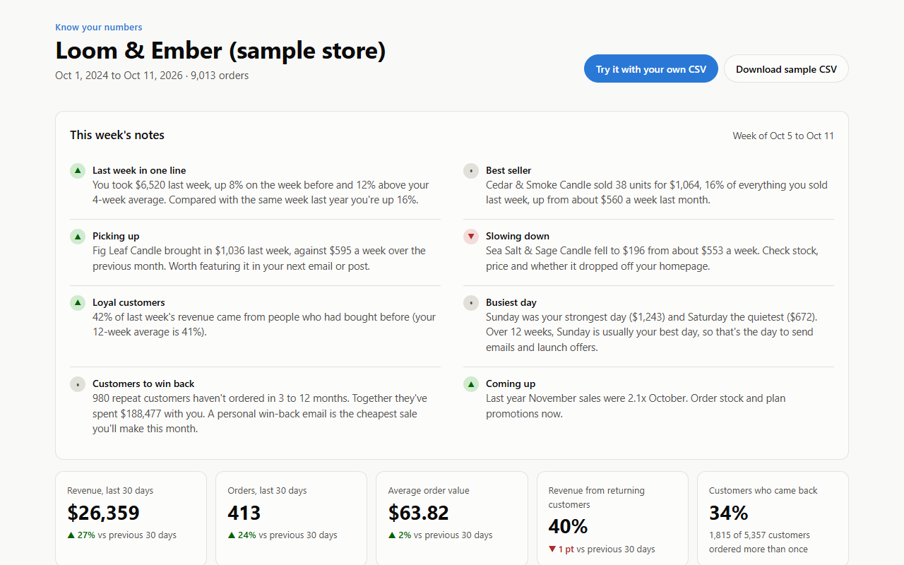
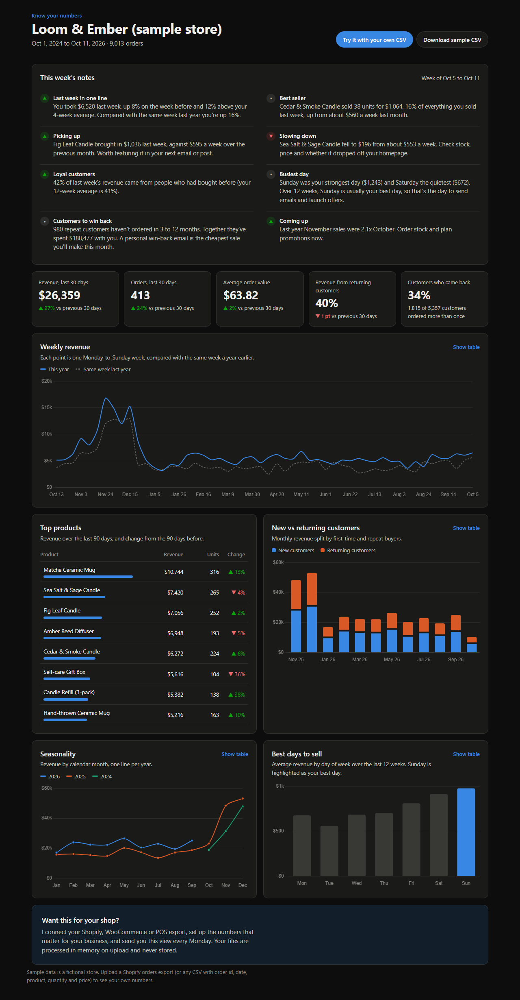
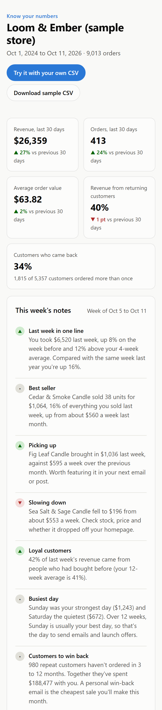
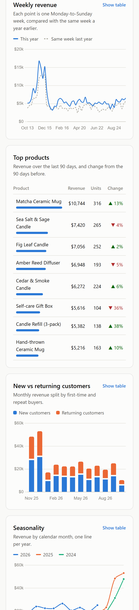
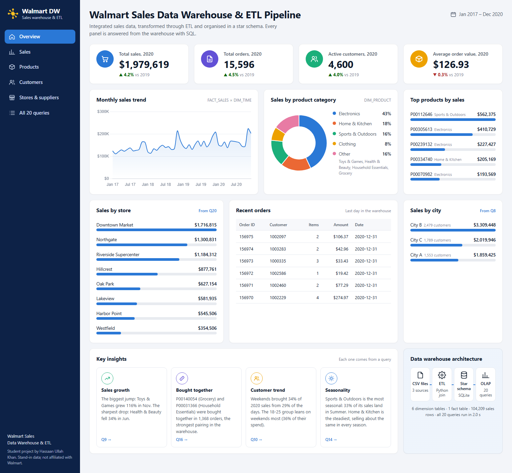
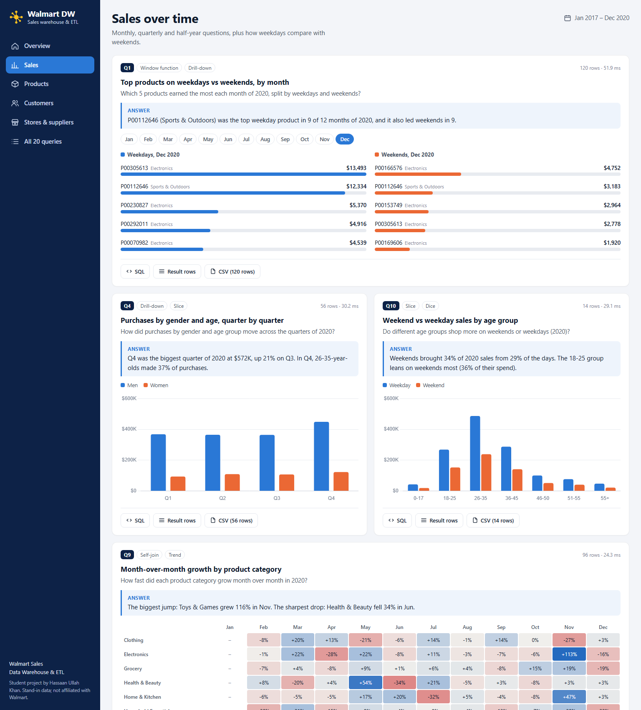
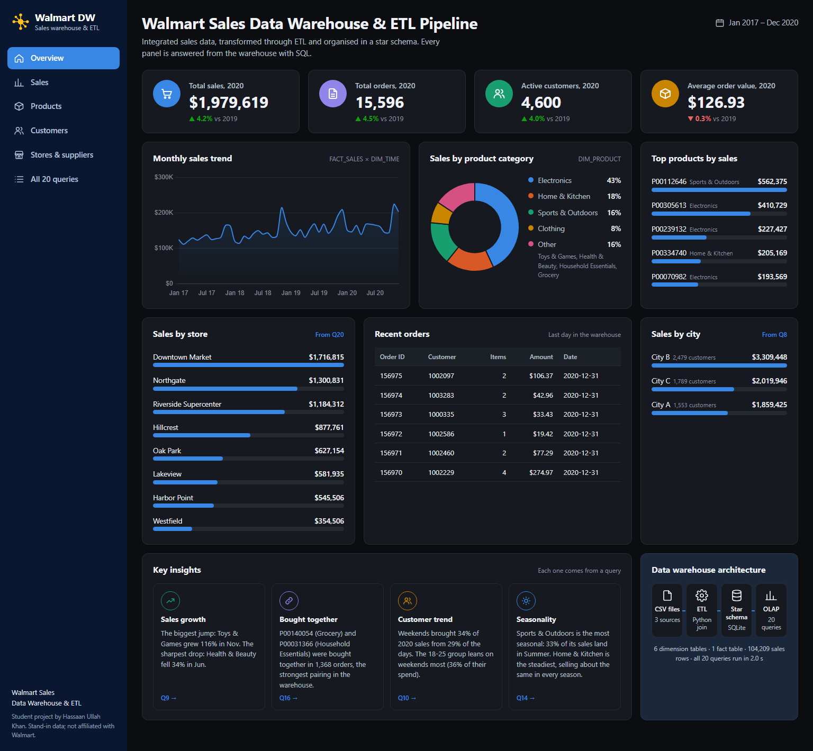
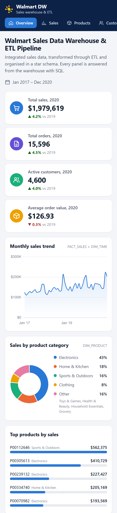

# Know Your Numbers: a sales dashboard for small online shops

A weekly sales dashboard for small e-commerce and retail businesses. Drop in a Shopify orders export (or any orders CSV) and see the numbers that matter, plus plain-English notes on what changed last week and what to do about it.

The same app also serves **[`/warehouse`](#walmart-sales-data-warehouse-the-20-olap-queries-answered)**: the original university project's Walmart star-schema warehouse, with every one of its 20 OLAP queries run and answered on one page.



**What it shows**

- **This week's notes**: an automatic summary of last week, for example "You took $6,520 last week, up 8% on the week before", the best seller, products picking up or slowing down, the busiest day, loyal-customer share, a win-back list, and what last year says about next month.
- **Key numbers**: revenue, orders, average order value and returning-customer revenue for the last 30 days against the 30 before, plus the share of customers who came back.
- **Weekly revenue trend** against the same week last year.
- **Top products** over 90 days, with change from the previous 90.
- **New vs returning customers**, month by month.
- **Seasonality**: revenue by calendar month, one line per year.
- **Best days to sell**: average revenue by weekday.

Every chart has a "Show table" view. Light and dark mode follow the device (or add `?theme=light` / `?theme=dark` to the URL), and the layout works at phone width.

**Try it with your own data:** click *Try it with your own CSV*. The file is processed in memory and never stored.

| Desktop (dark) | Phone |
|---|---|
|  |   |

Full-page light version: [screenshots/desktop.png](screenshots/desktop.png).

## Walmart Sales Data Warehouse: the 20 OLAP queries, answered

Open `/warehouse`. The star schema from [`original-warehouse-project/`](original-warehouse-project/) (6 dimension tables + `FACT_SALES`) is built in SQLite from the three source CSVs. Then all 20 queries from `queries_dw.sql` run, and each one gets its own panel:

- **The question** the query asks, and **a one-line answer** computed from its result ("Toys & Games grew 116% in November…").
- **A chart** suited to the result: grouped and stacked bars, heatmaps for occupation × category, month-over-month growth and store volatility, a month-by-month top-5 ranking for Q1, and a ranked list for the product pairs in Q16.
- **The SQL** that actually ran, with a note wherever MySQL syntax had to change for SQLite.
- **The result rows**: a preview, plus a CSV download of every row.

The overview page follows the classic BI layout: KPI cards (2020 vs 2019), monthly sales trend, sales by category, top products, sales by store, recent orders, sales by city, key insights linked to their queries, and the ETL architecture. Sections: Sales, Products, Customers, Stores & suppliers, and a list of all 20 queries.



| Query panels | Dark mode | Phone |
|---|---|---|
|  |  |  |

More: [stores & suppliers view](screenshots/warehouse-stores.png).

**Porting MySQL to SQLite.** Sixteen queries run unchanged. The other four:

| Query | MySQL | SQLite |
|---|---|---|
| Q6 | `DATE_SUB('2020-12-31', INTERVAL 6 MONTH)` | the date it evaluates to, `'2020-06-30'` |
| Q17 | `GROUP BY … WITH ROLLUP` | one `UNION ALL` branch per subtotal level, same rows and `ALL …` labels |
| Q19 | `STDDEV()` | population standard deviation, `sqrt(avg(x²) − avg(x)²)` |
| Q20 | `CREATE OR REPLACE VIEW` | `CREATE VIEW` |

The tests check the tricky ports against first principles: the ROLLUP grand total against the fact table, Q19's standard deviation recomputed in Python, and Q6's date window.

**About the data.** The project's source CSVs were never committed, so `scripts/generate_warehouse_data.py` recreates them in the **exact column layout the original ETL reads**, in `data/warehouse/`. It's a reduced-scale stand-in: the report's 5,891 customers, 8 stores, 7 suppliers and city categories A/B/C, with 400 products and 104,209 transaction rows (the original had 550,068). Orders run from 2017 to 2020, so the queries that filter on 2017 and 2020 all return data. All names are fictional. The page says so, and it isn't affiliated with Walmart. The whole build (load, then 20 queries) takes about 3 seconds and happens once per server process.

## Run it locally

Needs Python 3.10 or newer. No database server or API keys.

```bash
python -m venv .venv
.venv\Scripts\activate          # macOS/Linux: source .venv/bin/activate
pip install -r requirements-dev.txt
python app.py                   # http://localhost:5000 and /warehouse
pytest                          # 20 tests
```

## Deploy

The app is a single Flask service with no database (SQLite runs in memory), so it fits on free hosting tiers.

**Vercel**

1. Push this repo to GitHub.
2. In Vercel, choose *Add New → Project* and import the repo. Leave the framework preset as *Other*; `vercel.json` routes every request to `api/index.py`.
3. Optional: add `OWNER_NAME`, `OWNER_EMAIL` and `OWNER_BOOKING_LINK` under *Settings → Environment Variables* to show a "Book a call" button.
4. Deploy. The CLI works too: `npm i -g vercel`, then `vercel --prod`.

Vercel limits uploads to 4.5 MB, so the app accepts CSVs up to 4 MB, which is roughly 25,000 line items.

**Render**

1. Push the repo to GitHub.
2. In Render, choose *New → Blueprint* and pick the repo. `render.yaml` sets up a free web service running gunicorn, with a `/healthz` health check.
3. Fill in the optional `OWNER_*` variables when prompted.

The free Render tier sleeps after 15 minutes of inactivity, so the first visit after that takes about 30 seconds.

## CSV format

Columns are matched by name, so a raw **Shopify orders export** (Admin → Orders → Export → CSV) works as-is. Any other file works if it has these columns (common alternative names are accepted):

| Needed | Accepted headers |
|---|---|
| order id | `Name`, `Order ID`, `order_id` |
| date | `Created at`, `Date`, `order_date` (YYYY-MM-DD or MM/DD/YYYY) |
| product | `Lineitem name`, `Product`, `product_name` |
| quantity | `Lineitem quantity`, `Quantity`, `qty` |
| unit price | `Lineitem price`, `Price`, `unit_price` |
| customer (optional) | `Email`, `Customer`, `customer_id` |
| subtotal (optional) | `Subtotal`: order-level net sales after discounts |

Order revenue uses `Subtotal` when it's present (net of discounts, before shipping and tax). Otherwise it's quantity × price summed over the order. A customer is "returning" from their second order onwards. Weekly figures use complete Monday-to-Sunday weeks.

## How it works

```
app.py                      Flask routes: /, /api/upload, /sample.csv, /warehouse, /warehouse/q/<id>.csv, /healthz
dashboard/loader.py         CSV → in-memory SQLite (orders, lines), column matching, returning-customer flag
dashboard/analytics.py      KPIs, weekly trend, products, customer mix, seasonality, plain-English insights
templates/index.html        Page shell; the sample dashboard's data is embedded as JSON
static/app.js, app.css      Chart.js 4 charts, table views, upload flow, light/dark themes
scripts/generate_sample_data.py   Builds data/sample_orders.csv (seeded, reproducible)
warehouse/etl.py            Star schema DDL (ported from create_dw.sql) + load from data/warehouse/*.csv
warehouse/queries.py        The 20 OLAP queries ported to SQLite, with porting notes
warehouse/answers.py        Result rows → one-line answers, chart data, overview panels
templates/warehouse.html, static/warehouse.{js,css}   The warehouse page
scripts/generate_warehouse_data.py   Recreates the three source CSVs (seeded, reproducible)
api/index.py, vercel.json   Vercel entry point
render.yaml                 Render blueprint
```

The only runtime dependency is Flask (plus gunicorn on Render). All the analysis is plain Python and SQL, so a Shopify export loads and analyses in well under a second.

### Sample data

`data/sample_orders.csv` is a **fictional** store, "Loom & Ember" (home fragrance and ceramics): 9,013 orders from 5,357 customers between October 2024 and October 2026, in Shopify export format. It's generated by `scripts/generate_sample_data.py` with realistic patterns: steady growth, weekend peaks, a Black Friday and December rush, summer and holiday products, a new product taking off and an old one fading. Re-run the script to regenerate it; the seed keeps the output identical.

## History: the original university project

This repo started as a university data-warehousing project (Walmart sales star schema + HYBRIDJOIN streaming ETL into MySQL). That code is kept unchanged in [`original-warehouse-project/`](original-warehouse-project/). It didn't run as published, for these reasons:

- The three input CSVs (`data/customer_master_data.csv`, `product_master_data.csv`, `transactional_data.csv`) were never committed, so `main.py` exits with "File not found". Stand-ins in the same format now live in `data/warehouse/`; copy them to `original-warehouse-project/data/` to feed the original MySQL pipeline.
- It needs a local MySQL server, plus credentials typed in at an interactive prompt, so it can't be hosted or demoed.
- There's no `requirements.txt`. It imports `mysql-connector-python`, which isn't installed by default.
- The compiled `__pycache__` files were committed; they've been removed.

The `/warehouse` page brings that project back to life without a database server: same schema, same 20 queries, answered visually. The Know Your Numbers dashboard applies the same idea (fact and dimension style analysis in SQL) to a small business's own export.
